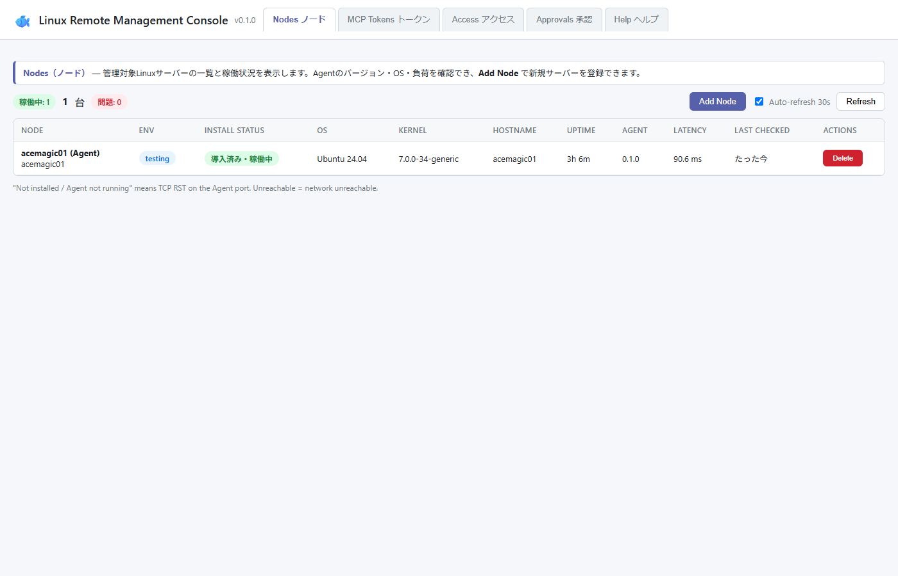
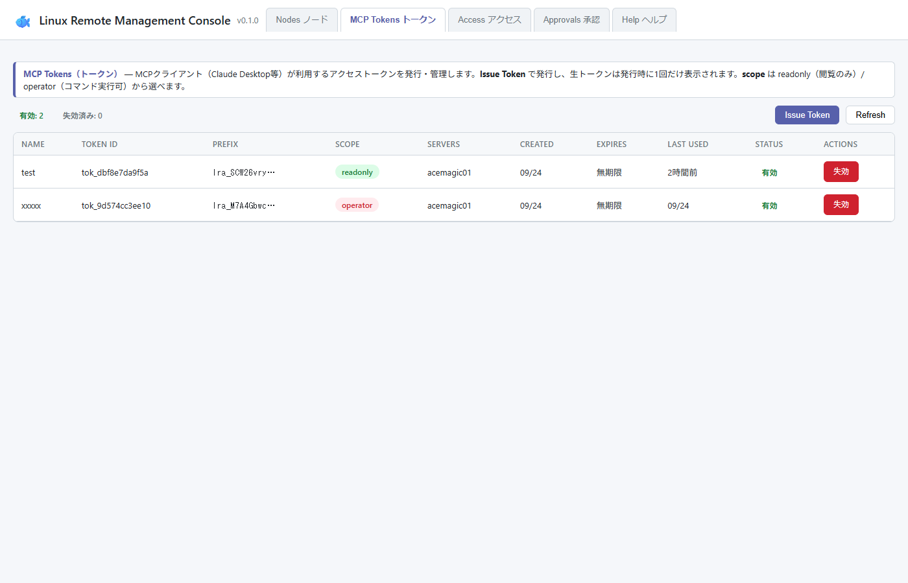
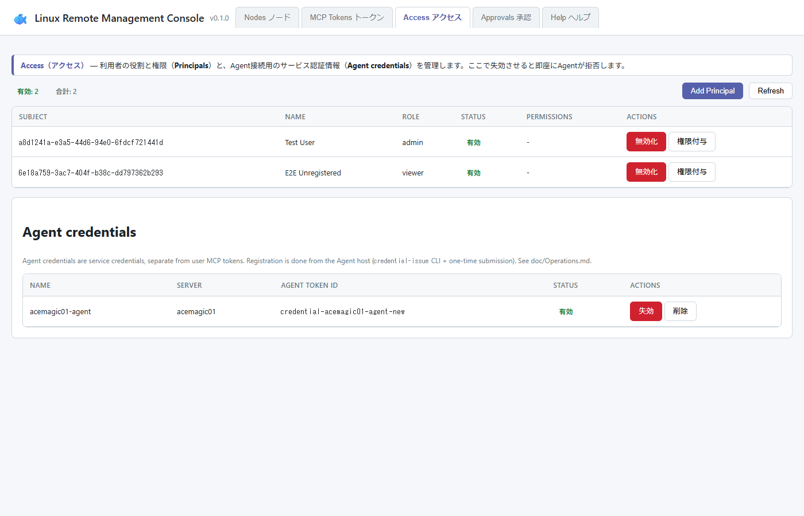
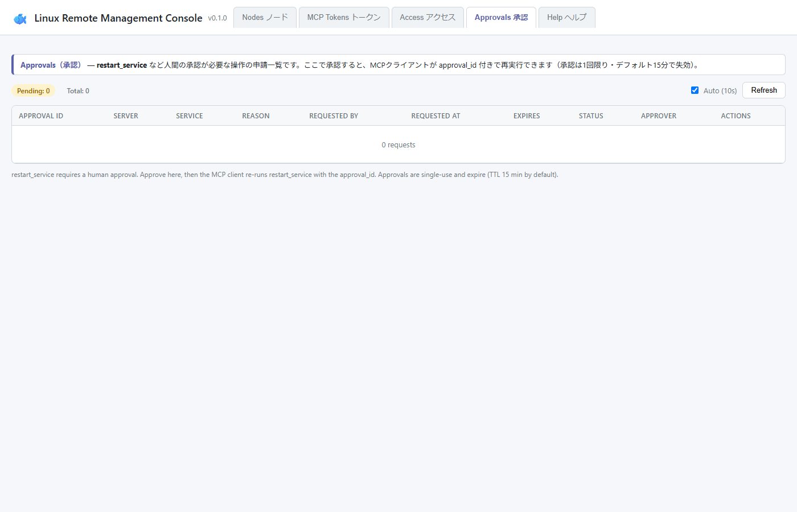
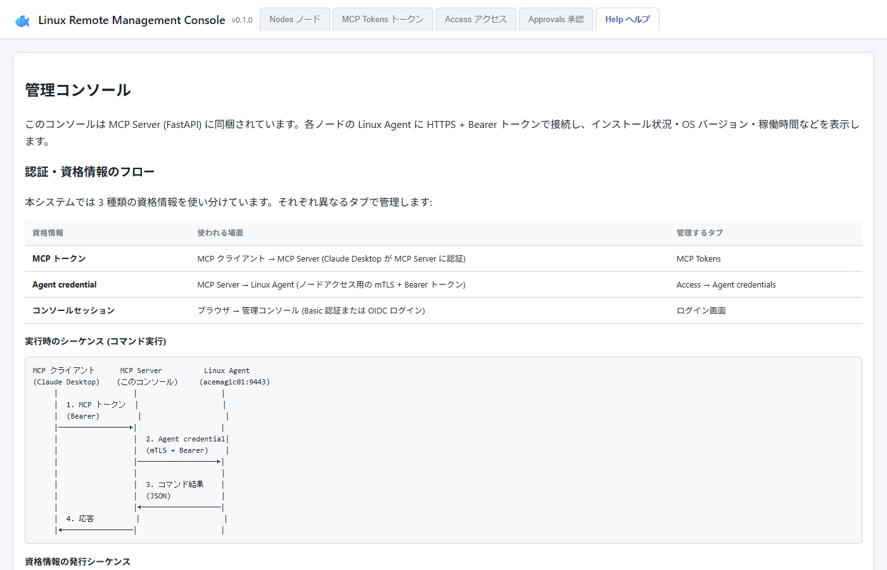

# Linux Remote Management MCP

Claude Desktop などの **AI クライアントから MCP プロトコル経由でリモート Linux サーバーを安全に操作する**ための管理基盤です。SSH を使わず、HTTPS + Bearer Token の構造化 API で Linux を管理できます。

---

## これは何？

```
Claude Desktop  ──MCP──▶  MCP Server  ──HTTPS + Bearer──▶  Linux Agent  ──▶  OS
  (AI クライアント)          (FastAPI)                         (Go バイナリ)
```

AI が「nginx を再起動して」と言うと、MCP Server が認可チェック・人間承認フローを経て Linux Agent に指示します。Agent は専用ユーザーで動作し、許可されたコマンドだけを実行します。

---

## スクリーンショット

### Nodes — 管理対象サーバーの稼働状況



登録した Linux サーバーのインストール状況・OS・カーネル・稼働時間・Agent バージョン・レイテンシを一覧表示します。30 秒ごとに自動リフレッシュ。

---

### MCP Tokens — AI クライアント用トークン発行



Claude Desktop などの MCP クライアントが使うアクセストークンを発行・管理します。スコープは `readonly`（閲覧のみ）/ `operator`（コマンド実行可）から選択。生トークンは発行時に 1 回だけ表示されます。

---

### Access — 利用者権限と Agent 認証情報



利用者の役割と権限（Principals）と、MCP Server → Linux Agent 間のサービス認証情報（Agent credentials）を管理します。ここで失効させると即座に Agent が拒否します。

---

### Approvals — 危険な操作の人間承認フロー



`restart_service` などの操作は AI が直接実行できず、人間の承認が必要です。承認すると MCP クライアントが `approval_id` 付きで再実行できます。承認は 1 回限り・デフォルト 15 分で失効します。

---

### Help — 認証フローと API リファレンス



3 種類の資格情報（MCP トークン / Agent credential / コンソールセッション）の役割と、コマンド実行時のシーケンスを図解しています。

---

## アーキテクチャ

```
┌─────────────────────────────────────────────────────────────────┐
│  AI クライアント (Claude Desktop / Codex 等)                     │
└────────────────────────┬────────────────────────────────────────┘
                         │ MCP (stdio / Streamable HTTP)
                         │ Bearer トークン認証
                         ▼
┌─────────────────────────────────────────────────────────────────┐
│  MCP Server (Python / FastAPI)                                  │
│  ┌──────────────┐  ┌────────────────┐  ┌───────────────────┐  │
│  │  管理コンソール│  │ MCP Tool 提供  │  │ 認可 / 承認フロー │  │
│  │  (Web UI)    │  │ get_system_info│  │ principal/role    │  │
│  │  :8080       │  │ restart_service│  │ 人間承認ゲート    │  │
│  └──────────────┘  │ read_file 等   │  └───────────────────┘  │
│                    └────────────────┘                          │
└────────────────────────┬────────────────────────────────────────┘
                         │ HTTPS + Bearer Token (+ mTLS オプション)
                         │ 専用 Agent credential
                         ▼
┌─────────────────────────────────────────────────────────────────┐
│  Linux Agent (Go バイナリ)                                       │
│  ┌─────────────┐  ┌───────────────┐  ┌──────────────────────┐ │
│  │ 認証        │  │ コマンド制限  │  │ 監査ログ             │ │
│  │ Bearer Token│  │ Allowlist     │  │ JSONL + ハッシュチェーン│ │
│  │ SHA-256比較 │  │ deny by default│  │ SIEM Webhook 転送   │ │
│  └─────────────┘  └───────────────┘  └──────────────────────┘ │
└────────────────────────┬────────────────────────────────────────┘
                         │ 専用 Unix ユーザー (非 root)
                         ▼
                    Linux OS (systemd / filesystem)
```

---

## MCP Tools 一覧

AI クライアントから呼び出せる操作です。

| ツール | 説明 | スコープ |
|--------|------|----------|
| `get_system_info` | ホスト名・OS・カーネル・稼働時間・メモリ | readonly |
| `get_disk_usage` | ディスク使用状況 (df 相当) | readonly |
| `get_processes` | プロセス一覧 (最大 100 件) | readonly |
| `get_service_status` | systemd サービスの状態確認 | readonly |
| `get_service_logs` | journalctl ログ取得 | readonly |
| `read_file` | ファイル読み取り (allowlist 内のみ) | readonly |
| `restart_service` | サービス再起動 (**人間承認が必要**) | operator |
| `execute_command` | コマンド実行 (allowlist 内のみ、**人間承認が必要**) | operator |

---

## セキュリティモデル

### 3 段階の認証境界

```
管理者          ── Basic 認証 / OIDC ──▶  管理コンソール (:8080)
MCP 利用者      ── MCP Bearer トークン ──▶  MCP Server (:8090)
MCP Server      ── mTLS + Agent credential ──▶  Linux Agent (:8443)
```

- **AI ≠ root**: Agent は専用 Unix ユーザーで動作、root 権限なし
- **deny by default**: allowlist に載っていないコマンド・ファイルは一切拒否
- **認証と認可を分離**: トークンは「誰か」を証明するだけ。「何ができるか」は scope と allowlist が決める
- **人間承認ゲート**: operator 操作は承認なしに実行不可
- **監査ログ**: 全操作を JSONL に記録。ハッシュチェーンで改ざん防止

### セキュリティレベル別構成

| Level | 用途 | 主な要件 |
|-------|------|----------|
| **1** | 個人・開発環境 | HTTPS + Bearer Token |
| **2** | VPS・検証環境 | + Private Network + Allowlist + Audit Log + 人間承認 |
| **3** | 本番・複数管理者 | + mTLS + Policy Engine + SIEM + Token ローテーション |

詳細は [doc/Security.md](doc/Security.md) を参照してください。

---

## クイックスタート

### 1. 管理コンソール起動 (Docker)

```bash
git clone https://github.com/Hana4219/Linux_Remote_Management_MCP.git
cd Linux_Remote_Management_MCP

# .env でパスワードを設定 (任意)
echo "LINUX_MCP_CONSOLE_PASS=your-password" >> .env

docker compose -f docker-compose.mcp.yml up -d

# → http://127.0.0.1:8080  管理コンソール
# → http://127.0.0.1:8090  MCP Streamable HTTP
```

### 2. Linux Agent を管理対象サーバーに導入

```bash
# Agent ホスト上で実行
cd lrm-mcp-agent
make build          # または make dist (Goなし環境はDocker)

# 専用ユーザー作成・systemd 登録・credential 発行・Console 登録まで一括
sudo ./scripts/setup.sh --provision
```

### 3. Claude Desktop に接続

`claude_desktop_config.json` に追加:

```json
{
  "mcpServers": {
    "linux-remote-management": {
      "command": "python",
      "args": ["-m", "app.mcp_entry"],
      "cwd": "/path/to/mcp-server",
      "env": {
        "LINUX_MCP_TOKEN": "<発行したMCPトークン>"
      }
    }
  }
}
```

または MCP Streamable HTTP を使う場合:

```json
{
  "mcpServers": {
    "linux-remote-management": {
      "url": "http://127.0.0.1:8090/mcp",
      "headers": {
        "Authorization": "Bearer <発行したMCPトークン>"
      }
    }
  }
}
```

---

## Linux Agent API エンドポイント

| メソッド | パス | 説明 |
|---------|------|------|
| GET | `/v1/health` | ヘルスチェック (認証不要) |
| GET | `/v1/system` | システム情報 |
| GET | `/v1/disk` | ディスク使用状況 |
| GET | `/v1/processes` | プロセス一覧 |
| GET | `/v1/services/{name}` | サービス状態 |
| POST | `/v1/services/{name}/restart` | サービス再起動 (operator) |
| GET | `/v1/services/{name}/logs` | サービスログ |
| GET | `/v1/files?path=...` | ファイル読み取り |
| POST | `/v1/execute` | コマンド実行 (operator) |
| GET | `/metrics` | Prometheus メトリクス |

---

## ディレクトリ構成

```
Linux_Remote_Management_MCP/
├── mcp-server/          # Python / FastAPI (MCP Server + 管理コンソール)
│   ├── app/             # アプリケーションコード
│   ├── config.yml       # サーバー・Agent・認証設定
│   └── data/            # tokens.db (SQLite, 0600) ← Git 除外
├── lrm-mcp-agent/       # Go (Linux Agent バイナリ)
│   ├── internal/agent/  # 認証・API・ポリシーエンジン
│   ├── cmd/             # lrm-mcp-agent / credential-issue CLI
│   ├── scripts/         # setup.sh / systemd unit / firewall
│   └── config.yml       # Agent 設定 (token hash / allowlist)
├── console/             # 管理コンソール UI (FastAPI + vanilla JS)
├── doc/                 # 設計書・運用マニュアル・スクリーンショット
│   ├── Design.md        # アーキテクチャ設計
│   ├── Security.md      # セキュリティレベル別構成
│   ├── Operations.md    # 運用マニュアル (token ローテーション等)
│   └── screenshots/     # 本 README の画面キャプチャ
└── docker-compose.mcp.yml
```

---

## ドキュメント

| ドキュメント | 内容 |
|-------------|------|
| [doc/Design.md](doc/Design.md) | アーキテクチャ・設計思想・セキュリティ目標 |
| [doc/Security.md](doc/Security.md) | Level 1〜3 セキュリティ構成ガイド |
| [doc/Operations.md](doc/Operations.md) | セットアップ・トークン管理・障害対応 |
| [doc/mTLS.md](doc/mTLS.md) | mTLS 設定手順 |
| [doc/OIDC.md](doc/OIDC.md) | OIDC 認証設定 |
| [lrm-mcp-agent/README.md](lrm-mcp-agent/README.md) | Linux Agent ビルド・設定・デプロイ詳細 |

---

## ライセンス

MIT
